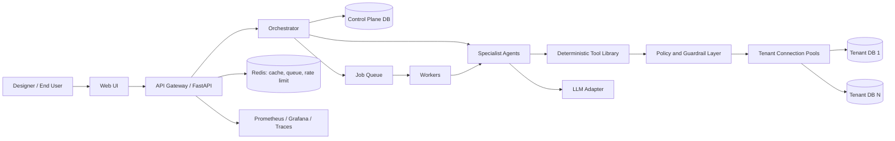
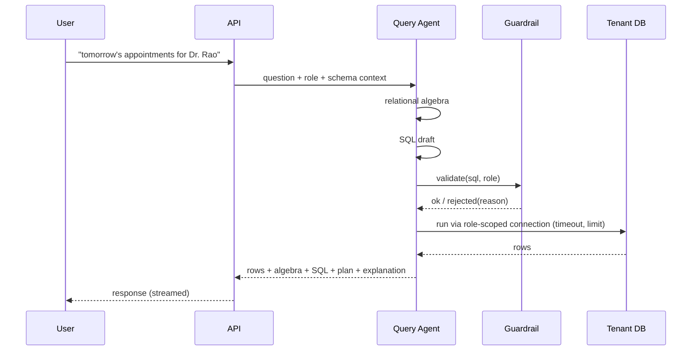

# ARCHITECTURE.md

## 1. High-Level View



## 2. Layers

| Layer | Responsibility | Tech |
|---|---|---|
| Presentation | Forms, ER diagram view, query console, approvals | React, Mermaid, WebSocket |
| API | Auth, validation, rate limiting, streaming | FastAPI, Pydantic |
| Orchestration | Intent routing, state, approvals | Python, state machine |
| Agents | LLM reasoning with tool calls | LLM adapter |
| Tool library | Closure, normalization, ER mapping, SQL validation, DDL gen | Pure Python, sqlglot |
| Guardrails | AST policy, RBAC, limits, timeouts | sqlglot + Postgres roles |
| Data plane | Per-tenant databases | PostgreSQL |
| Control plane | Tenants, projects, schemas, roles, audit | PostgreSQL |
| Infra | Cache, queue, metrics | Redis, Arq/Celery, Prometheus |

## 3. Key Flows

### 3.1 Design to Deploy
1. User submits requirements -> API creates `project` and enqueues a design job.
2. Design Agent produces `er_model`; UI shows diagram; user edits and approves.
3. Schema Agent runs mapping, FD analysis, normalization; user confirms FDs and decomposition.
4. Security Agent produces roles/views; `simulate_access` verifies.
5. Deployer creates tenant database, runs DDL in one transaction, creates roles, stores `schema_version`.

### 3.2 Natural Language Query


### 3.3 Write with Approval
Query Agent produces write plan -> Transaction Agent dry-runs in a rolled-back transaction -> shows affected rows -> user approves -> commit -> audit entry with before-image.

## 4. Tenant Isolation Model
- **Database-per-tenant** on a shared Postgres cluster (v1); optionally schema-per-tenant for small tenants.
- Each tenant has distinct DB roles per business role (`t_{id}_receptionist`).
- The control plane never stores tenant business data, only metadata.
- Connection pools keyed by `(tenant, role)` with global caps.

## 5. LLM Adapter
```python
class LLM(Protocol):
    async def complete(self, messages, tools=None, schema=None) -> LLMResult: ...
```
Implementations: `OpenAIAdapter`, `AnthropicAdapter`, `LocalAdapter`, `MockAdapter` (deterministic, used in tests and stress tests).

## 6. Repository Layout
```
dbforge/
├── backend/
│   ├── api/                # routers, auth, schemas
│   ├── orchestrator/       # router, state machine, approvals
│   ├── agents/
│   │   ├── design.py  schema.py  security.py  query.py
│   │   ├── transaction.py  tuning.py  evolution.py  recovery.py
│   │   └── prompts/
│   ├── tools/
│   │   ├── er/             # validate, mermaid
│   │   ├── fd/             # closure, keys, cover
│   │   ├── normalization/  # nf checks, decomposition
│   │   ├── mapping/        # er_to_relational
│   │   ├── sql/            # validator, algebra, ddl
│   │   └── tuning/         # explain parser, index advisor
│   ├── guardrails/
│   ├── tenancy/            # provisioning, pools
│   ├── llm/                # adapters
│   ├── db/                 # control-plane models, migrations
│   └── workers/
├── web/
├── tests/                  # unit, integration, evals, stress
├── docs/
├── docker-compose.yml
└── .env.example
```

## 7. Architectural Decisions (ADR summary)

| # | Decision | Why |
|---|---|---|
| 1 | Postgres for both planes | One technology; rich `EXPLAIN`, roles, RLS |
| 2 | sqlglot for SQL AST | Dialect-aware parsing for validation and algebra |
| 3 | Algebra generated from AST, not trusted from LLM | Verifiable consistency |
| 4 | Job queue for LLM-heavy work | Keeps API responsive under load |
| 5 | MockAdapter | Enables repeatable stress tests without LLM cost |
| 6 | DB-per-tenant | Strong isolation and simple backup/restore |
