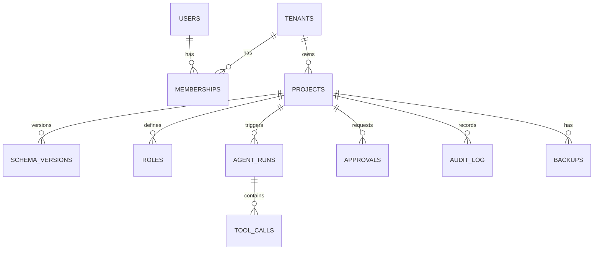

# DATABASE_SCHEMA.md
Control-plane metadata (PostgreSQL). Tenant business data lives in separate databases.



```sql
CREATE TABLE tenants (
  tenant_id     UUID PRIMARY KEY DEFAULT gen_random_uuid(),
  name          TEXT NOT NULL UNIQUE,
  db_host       TEXT NOT NULL,
  db_name       TEXT NOT NULL,
  plan          TEXT NOT NULL DEFAULT 'free',
  rate_limit_rps INT NOT NULL DEFAULT 20,
  created_at    TIMESTAMPTZ NOT NULL DEFAULT now()
);

CREATE TABLE users (
  user_id       UUID PRIMARY KEY DEFAULT gen_random_uuid(),
  email         TEXT NOT NULL UNIQUE,
  password_hash TEXT NOT NULL,
  created_at    TIMESTAMPTZ NOT NULL DEFAULT now()
);

CREATE TABLE memberships (
  user_id    UUID REFERENCES users ON DELETE CASCADE,
  tenant_id  UUID REFERENCES tenants ON DELETE CASCADE,
  platform_role TEXT NOT NULL CHECK (platform_role IN ('designer','end_user','admin')),
  db_role    TEXT,                     -- business role inside tenant DB
  PRIMARY KEY (user_id, tenant_id)
);

CREATE TABLE projects (
  project_id  UUID PRIMARY KEY DEFAULT gen_random_uuid(),
  tenant_id   UUID NOT NULL REFERENCES tenants,
  name        TEXT NOT NULL,
  stage       TEXT NOT NULL CHECK (stage IN ('design','schema','security','deployed','evolving')),
  requirements_text TEXT,
  state_json  JSONB NOT NULL DEFAULT '{}',       -- ProjectState
  created_at  TIMESTAMPTZ NOT NULL DEFAULT now(),
  UNIQUE (tenant_id, name)
);

CREATE TABLE schema_versions (
  project_id  UUID REFERENCES projects ON DELETE CASCADE,
  version     INT,
  er_json     JSONB NOT NULL,
  relational_json JSONB NOT NULL,
  fds_json    JSONB NOT NULL,
  ddl         TEXT NOT NULL,
  migration_up   TEXT,
  migration_down TEXT,
  applied_at  TIMESTAMPTZ,
  PRIMARY KEY (project_id, version)
);

CREATE TABLE roles (
  role_id     UUID PRIMARY KEY DEFAULT gen_random_uuid(),
  project_id  UUID NOT NULL REFERENCES projects ON DELETE CASCADE,
  name        TEXT NOT NULL,
  description TEXT,
  policy_json JSONB NOT NULL,          -- visible columns, row filters, allowed actions
  UNIQUE (project_id, name)
);

CREATE TABLE agent_runs (
  run_id      UUID PRIMARY KEY DEFAULT gen_random_uuid(),
  project_id  UUID REFERENCES projects,
  user_id     UUID REFERENCES users,
  agent       TEXT NOT NULL,
  input_json  JSONB,
  output_json JSONB,
  status      TEXT NOT NULL,           -- queued|running|succeeded|failed|needs_approval
  llm_tokens_in INT, llm_tokens_out INT, latency_ms INT,
  started_at  TIMESTAMPTZ NOT NULL DEFAULT now(),
  finished_at TIMESTAMPTZ
);

CREATE TABLE tool_calls (
  call_id   BIGSERIAL PRIMARY KEY,
  run_id    UUID NOT NULL REFERENCES agent_runs ON DELETE CASCADE,
  tool      TEXT NOT NULL,
  args_json JSONB, result_json JSONB,
  ok        BOOLEAN, duration_ms INT,
  created_at TIMESTAMPTZ NOT NULL DEFAULT now()
);

CREATE TABLE approvals (
  approval_id UUID PRIMARY KEY DEFAULT gen_random_uuid(),
  project_id  UUID NOT NULL REFERENCES projects,
  requested_by UUID REFERENCES users,
  action_type TEXT NOT NULL,           -- migration|bulk_write|drop|index
  risk        TEXT NOT NULL CHECK (risk IN ('low','medium','high')),
  payload_json JSONB NOT NULL,
  preview_json JSONB,
  status      TEXT NOT NULL DEFAULT 'pending' CHECK (status IN ('pending','approved','rejected','expired')),
  decided_by  UUID REFERENCES users,
  decided_at  TIMESTAMPTZ
);

CREATE TABLE audit_log (               -- append-only; partition by month
  audit_id    BIGSERIAL,
  project_id  UUID NOT NULL,
  user_id     UUID,
  action      TEXT NOT NULL,
  sql_text    TEXT,
  before_image JSONB,
  rows_affected INT,
  created_at  TIMESTAMPTZ NOT NULL DEFAULT now(),
  PRIMARY KEY (audit_id, created_at)
) PARTITION BY RANGE (created_at);
REVOKE UPDATE, DELETE ON audit_log FROM PUBLIC;

CREATE TABLE backups (
  backup_id   UUID PRIMARY KEY DEFAULT gen_random_uuid(),
  project_id  UUID NOT NULL REFERENCES projects,
  location    TEXT NOT NULL,
  kind        TEXT CHECK (kind IN ('logical','base','pitr_marker')),
  created_at  TIMESTAMPTZ NOT NULL DEFAULT now()
);

CREATE TABLE slow_queries (
  id BIGSERIAL PRIMARY KEY,
  project_id UUID NOT NULL,
  fingerprint TEXT NOT NULL,
  sample_sql TEXT, calls INT, mean_ms NUMERIC, p95_ms NUMERIC,
  last_seen TIMESTAMPTZ DEFAULT now()
);

CREATE INDEX ON agent_runs (project_id, started_at DESC);
CREATE INDEX ON tool_calls (run_id);
CREATE INDEX ON audit_log (project_id, created_at DESC);
CREATE INDEX ON approvals (project_id, status);
CREATE INDEX ON slow_queries (project_id, fingerprint);
```

## Normalization Note
The control plane itself is kept in 3NF; JSONB columns are used only for versioned artifacts (ER models, policies) that are always read and written whole. This is a deliberate, documented denormalization.
