<div align="center">

<picture>
  <source media="(prefers-color-scheme: dark)" srcset="docs/brand/wordmark-dark.png">
  
</picture>

### Your data, but make it normal.

A database copilot for PostgreSQL. Describe what you're building in plain English, and Normie
designs the schema, normalises it, writes the SQL, secures it with roles, and **waits for your
approval before anything changes**.


[**Quickstart**](#-quickstart) · [**How it works**](#-how-it-works) · [**Features**](#-features) · [**DBMS syllabus**](#-built-on-the-dbms-syllabus) · [**Deploy**](deploy/README.md) · [**Full write-up**](docs/HOW_IT_WORKS.md)

</div>

<br>

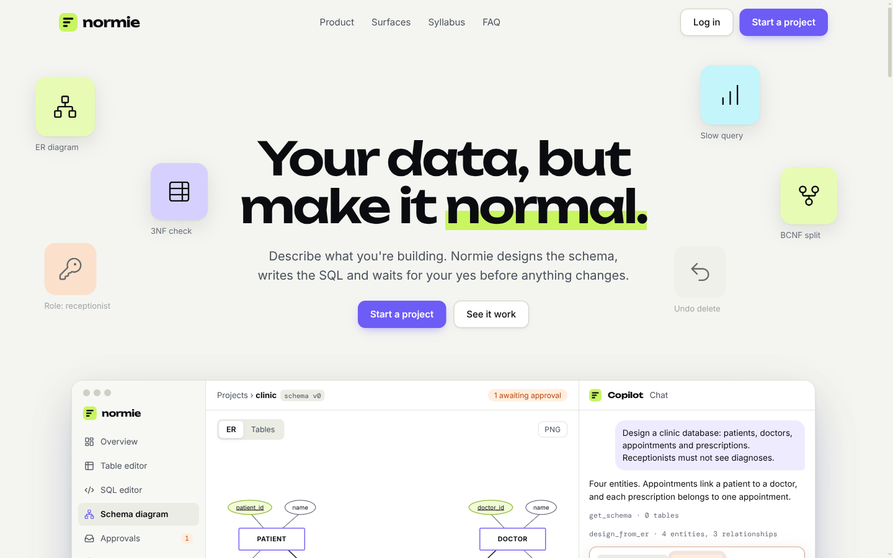

---

## ✦ What is Normie?

Most database tools assume you already know SQL, normal forms and role-based security. Most AI
assistants know them, but will happily run a `DELETE` on your production table. **Normie sits in
between.** It is a Supabase-style platform where:

- **Every project gets a real PostgreSQL database** with three generated logins (owner, read-write,
  read-only). You can connect to it with `psql` or any client.
- **A copilot does the work in plain English.** It designs ER models, maps them to tables, finds
  functional dependencies, splits tables into 3NF or BCNF, writes queries, creates roles and tunes
  indexes.
- **Nothing risky happens without you.** Every write and migration is rehearsed inside a
  transaction that is rolled back, so you see exactly which rows it would touch, scored for risk,
  and held until you click **Approve**. Updates and deletes keep before-images, so they can be undone.
- **Theory does the deciding.** Attribute closure, candidate keys, normal-form checks and SQL
  validation are plain, tested code. The language model proposes; the algorithms decide.

<div align="center">

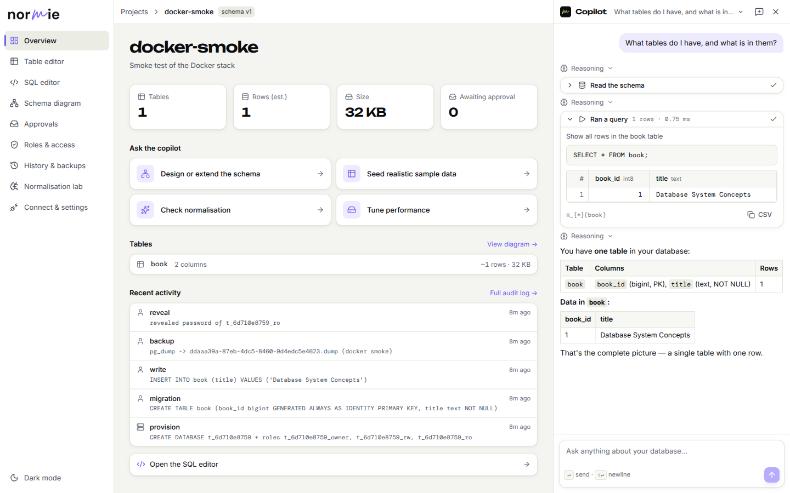

<sub>The copilot reads the schema, runs a query on a read-only login, shows the relational algebra (π) under the result and explains it. Every step lands in the audit log on the left.</sub>

</div>

---

## ✦ Features

<table>
<tr>
<td width="50%" valign="top">

**ER diagrams in Chen notation**<br>
<sub>Drawn from your live tables: keys, cardinality, total participation (double lines), weak entities. Foreign keys become relationships automatically.</sub>

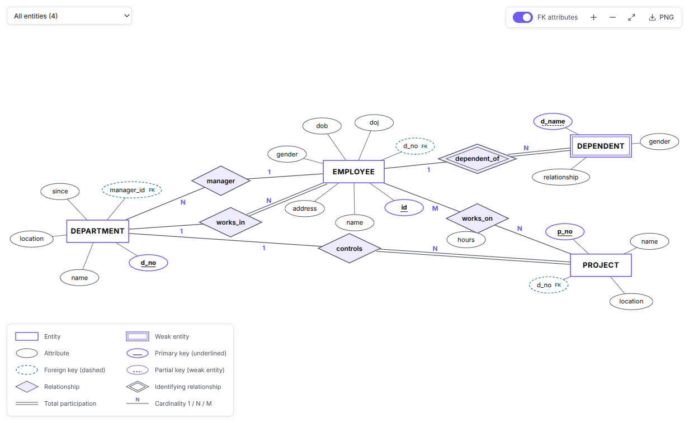

</td>
<td width="50%" valign="top">

**The approval gate**<br>
<sub>Every change is dry-run for real, risk-scored (low, medium, high) and waits for a human. The card shows the SQL, rows touched and what has (not) changed yet.</sub>

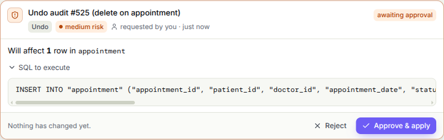

</td>
</tr>
<tr>
<td valign="top">

**SQL editor with relational algebra**<br>
<sub>CodeMirror with schema autocomplete, <code>EXPLAIN</code> / <code>EXPLAIN ANALYZE</code>, and the algebra of every query beside the result.</sub>

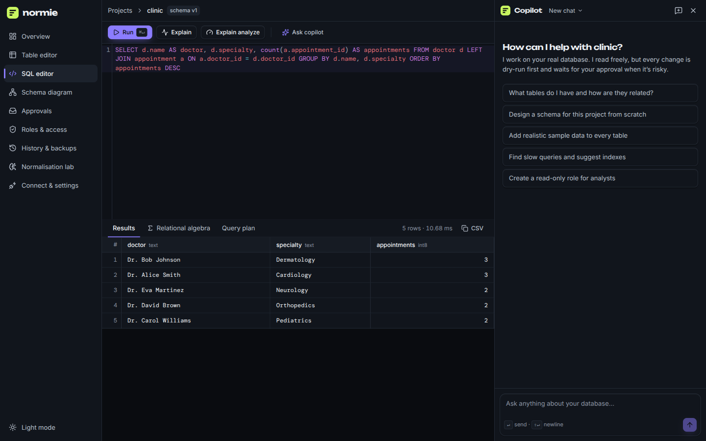

</td>
<td valign="top">

**Table editor and schema diagram**<br>
<sub>Browse, sort and edit rows (edits go through the approval gate too), or see the physical schema read straight from <code>pg_catalog</code>.</sub>

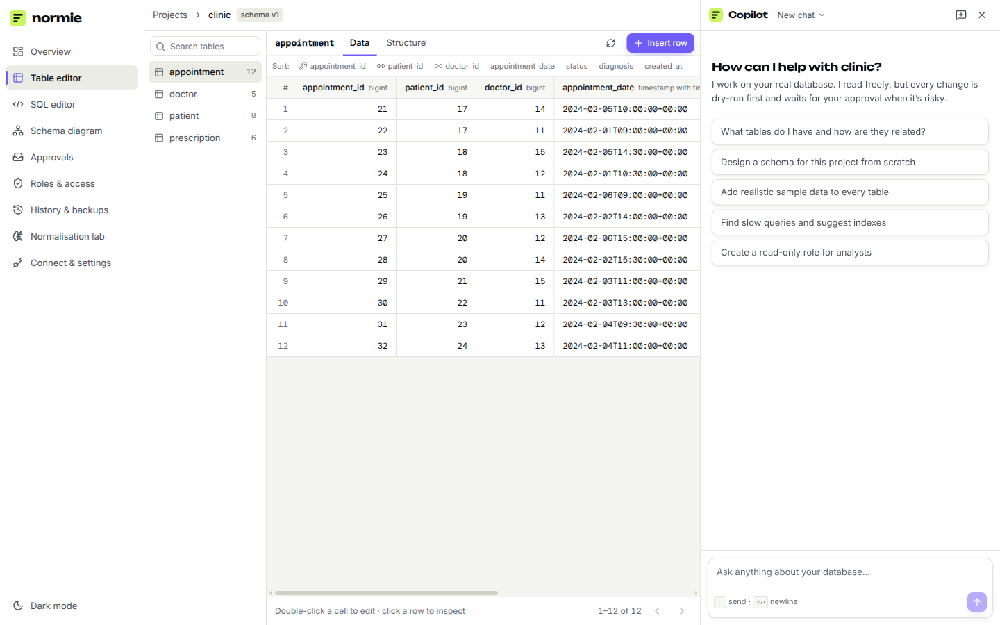

</td>
</tr>
<tr>
<td valign="top">

**Project overview**<br>
<sub>Tables, row estimates, size, pending approvals, one-click copilot tasks and the recent audit log.</sub>

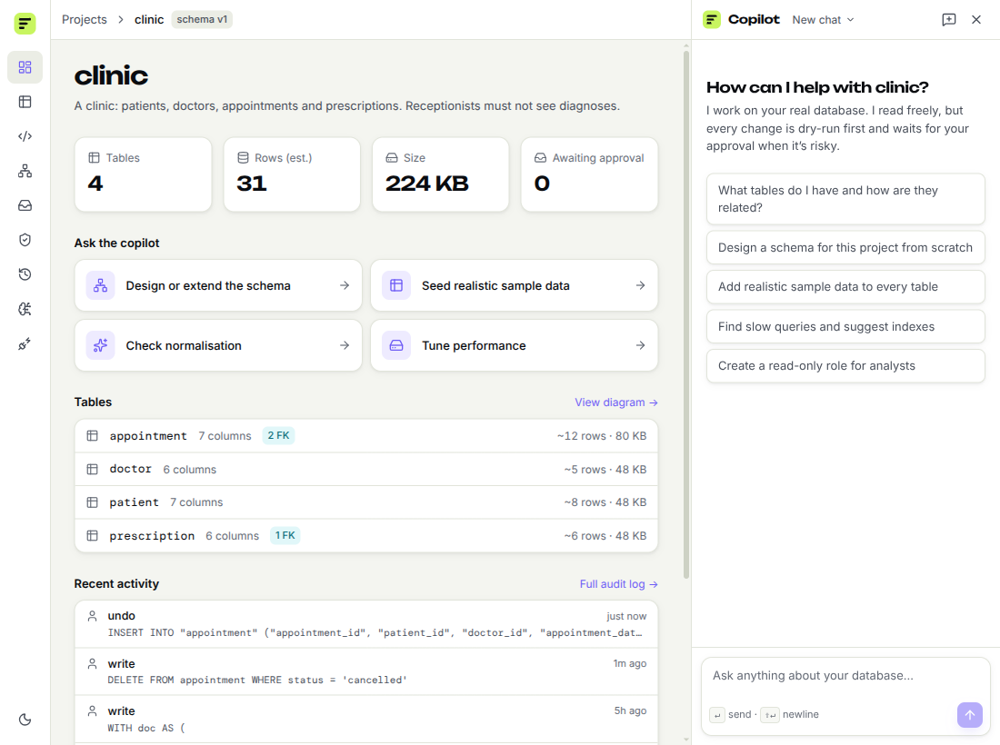

</td>
<td valign="top">

**Works on a phone**<br>
<sub>Responsive by construction (container queries and intrinsic grids, not breakpoints): approvals and connection strings on a 390 px screen.</sub>

<p align="center">
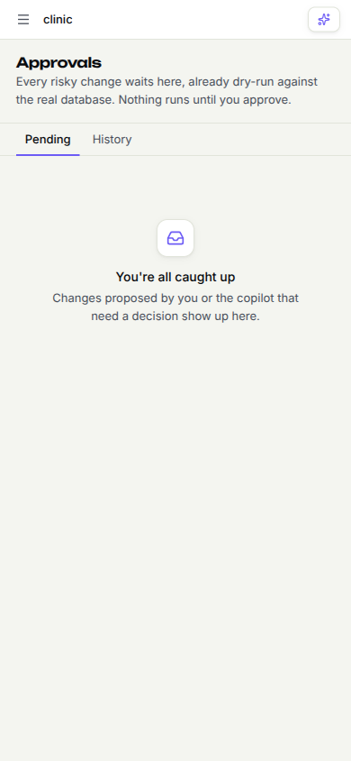
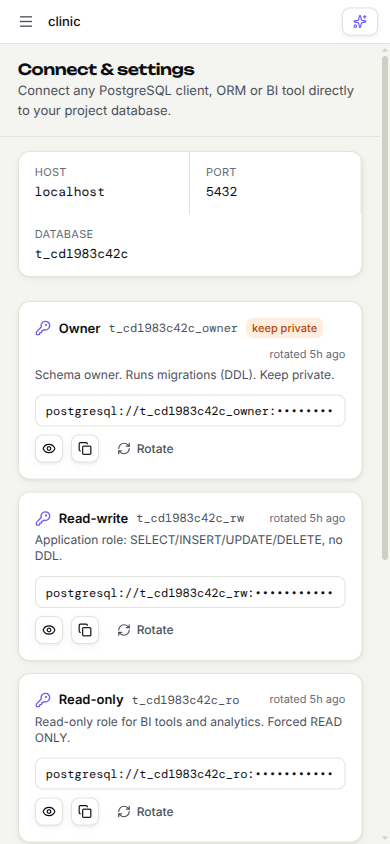
</p>

</td>
</tr>
</table>

**Also inside:**

| | |
|---|---|
| 🧪 **Normalisation lab** | Declared FDs from your keys, *observed* FDs found in your rows (you confirm them), normal form, and a generated 3NF / BCNF decomposition with a lossless join-back check. |
| 🔐 **Roles and access** | "Receptionists can book appointments but not see diagnoses" becomes a role with column `GRANT`s, views and row-level security, tested with simulated statements before it is applied. |
| ↩️ **History, undo and backups** | Append-only audit log, undo from before-images, schema versions with up/down scripts, and `pg_dump` backups with restore. |
| ⚡ **Tuning** | Slow-query log, `EXPLAIN` plans and *what-if* indexes benchmarked inside a rolled-back transaction before anything is built. |
| 🔑 **Secure credentials** | Generated passwords encrypted at rest (Fernet), revealed only on request (and logged), rotated in one click. The read-only login is forced `READ ONLY` by PostgreSQL itself. |

---

## ✦ How it works

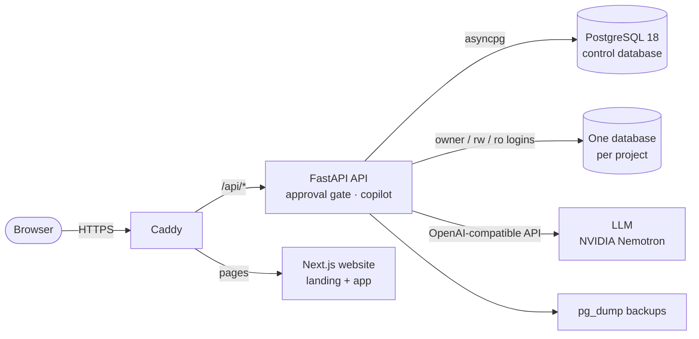

**Every change follows the same path,** whether it comes from you, the table editor or the copilot:

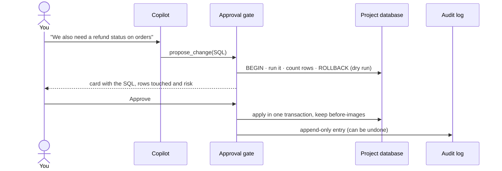

**Two independent layers decide what may run:**
1. **Normie's policy:** every statement is parsed with `sqlglot` and classified. Dangerous functions
   are blocked, statements hidden inside a `SELECT` (data-modifying CTEs) are caught, and risk is
   scored from the real dry-run row count.
2. **PostgreSQL itself:** the copilot reads through a read-only login, so even if the first layer
   were fooled, the database refuses the write.

---

## ✦ Built on the DBMS syllabus

Normie is a working answer to "where is this used?" for each syllabus topic:

| Topic | Where Normie uses it |
|---|---|
| ER model, weak entities, participation | Design specialist; Chen diagrams reverse-engineered from foreign keys |
| ER → relational mapping, keys | Generated DDL with primary keys, foreign keys and junction tables |
| Functional dependencies, closure, candidate keys | Normalisation lab and the `discover_fds` / `analyze_normalization` tools |
| 1NF → BCNF, lossless and dependency-preserving splits | Generated decomposition migrations with a join-back check |
| Relational algebra and SQL | Algebra tab in the SQL editor and under every copilot query |
| Transactions, ACID, isolation | Dry runs that roll back; approved changes commit all-or-nothing |
| Concurrency control | `SELECT … FOR UPDATE` so one approval can never be applied twice |
| Authorisation, views, `GRANT` / `REVOKE`, RLS | Per-project login roles and business roles |
| Indexing and query optimisation | `EXPLAIN (ANALYZE, BUFFERS)` and what-if index benchmarks |
| Logging and recovery | Append-only audit log, before-image undo, `pg_dump` / `pg_restore` |

The deck in [`docs/Normie-presentation.pptx`](docs/Normie-presentation.pptx) walks through each one with the real SQL the project runs.

---

## ✦ Quickstart

### With Docker (recommended: one command)

```bash
cp deploy/.env.docker.example .env.docker   # fill in the secrets (generator commands are in the file)
docker compose --env-file .env.docker up -d --build
open http://localhost
```

This starts PostgreSQL 18, the API, the website and Caddy. Data lives in Docker volumes. The same
command on a cloud server with `DOMAIN=yourdomain.com` gives you automatic HTTPS. See
[`deploy/README.md`](deploy/README.md) for the full guide.

### For development

Needs Python 3.12+ with [uv](https://docs.astral.sh/uv/), Node 22 and a PostgreSQL superuser.

```bash
./scripts/bootstrap.sh   # generates JWT_SECRET / CREDENTIALS_KEY into .env (never overwrites)
# set DATABASE_URL in .env, e.g. postgresql://postgres:<password>@localhost:5432/control
# set AGENT_API_KEY (NVIDIA NIM, or any OpenAI-compatible endpoint)
./scripts/dev.sh         # API on :8000 (auto-reload) + web on :3000
```

**Try it:** create a project and type *"A clinic: patients book appointments with doctors, and
receptionists must not see diagnoses."* Then approve the schema, seed sample data, ask *"Which
doctors have the most appointments?"* and open the ER diagram.

### Tests

```bash
uv run pytest -q                              # 37 tests against a real PostgreSQL
cd frontend && npx tsc --noEmit && npx eslint src
```

---

## ✦ Tech stack

| Layer | Technology |
|---|---|
| Backend | Python, FastAPI, asyncpg, pydantic-settings, argon2 + JWT (httpOnly cookie), Fernet |
| Agent | PydanticAI with specialist toolsets (design, query, change, security, tuning, recovery), any OpenAI-compatible LLM |
| SQL analysis | sqlglot (classification, risk, relational algebra) |
| Database | PostgreSQL 18: one database and three login roles per project |
| Frontend | Next.js 16 (App Router), React 19, Tailwind CSS 4, TanStack Query, CodeMirror 6, React Flow, Radix UI |
| Design | Unbounded · Inter · DM Mono, light and dark themes, View Transitions; logo made in Canva ([brand guide](docs/brand/README.md)) |
| Deployment | Docker Compose, Caddy (automatic HTTPS) |

## ✦ Project structure

```
backend/            FastAPI app
  agent/            the copilot (PydanticAI) and its versioned prompt
  api/              HTTP routes
  core/             config, security, connection pools, control-plane schema
  services/         approval gate, executor (dry runs, undo), SQL policy, roles, backups, normalisation
  tenancy/          creates, rotates and deletes project databases and roles
  tools/            deterministic DBMS theory: closure, keys, normal forms, ER mapping
frontend/           Next.js website: landing page (/) and the app (/projects, /p/[id]/…)
deploy/             Dockerfiles, Caddyfile, deployment guide
docs/               HOW_IT_WORKS.md, brand assets, screenshots, the presentation
tests/              unit + integration tests (real PostgreSQL)
legacy/             the previous implementation, kept for reference
```

## ✦ Documentation

| Document | What it covers |
|---|---|
| [`docs/HOW_IT_WORKS.md`](docs/HOW_IT_WORKS.md) | **Start here.** What is built and running today, in plain English: architecture, safety model, copilot, UI, syllabus mapping and a 5-minute demo script |
| [`deploy/README.md`](deploy/README.md) | Running with Docker on a laptop or a server |
| [`docs/brand/README.md`](docs/brand/README.md) | Logo files, colours and where each is used |
| [`PRODUCT.md`](PRODUCT.md) · [`ARCHITECTURE.md`](ARCHITECTURE.md) · [`SYSTEM_DESIGN.md`](SYSTEM_DESIGN.md) | The original vision and design |
| [`AGENTS.md`](AGENTS.md) | The agent design: roles, tools, guardrails |
| [`SECURITY.md`](SECURITY.md) · [`TESTING.md`](TESTING.md) · [`STRESS_TESTING.md`](STRESS_TESTING.md) | Threat model and test strategy |
| [`SYLLABUS_MAPPING.md`](SYLLABUS_MAPPING.md) | Every DBMS topic mapped to a component |
| [`API.md`](API.md) · [`DATABASE_SCHEMA.md`](DATABASE_SCHEMA.md) · [`DESIGN.md`](DESIGN.md) · [`ROADMAP.md`](ROADMAP.md) | API, control-plane tables, UI design and plan |

---

<div align="center">


**Normie** · a DBMS project by **Aakshant Kumar**

© 2026 Aakshant Kumar. All rights reserved.
</div>
