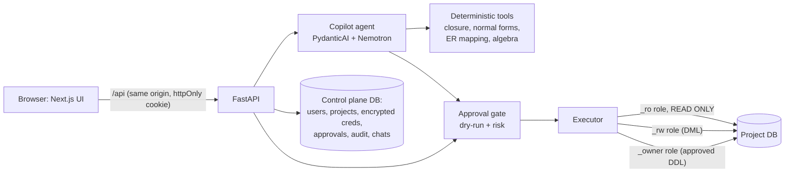

# Normie: how it works (plain-English write-up)

> **One sentence:** Normie is a Supabase-style platform where every project gets its own real
> PostgreSQL database with secure credentials, and an AI copilot that can design the schema,
> write and run SQL, add data, secure it with roles, tune it and undo mistakes. It does all of
> this through deterministic tools, and nothing risky happens without the human clicking *Approve*.

This document explains what was built, why each decision was made, and how to demo it. The
other docs (`PRODUCT.md`, `AGENTS.md`, `ARCHITECTURE.md`, …) describe the original vision; this
file describes **what actually exists and runs today**.

---

## 1. What was wrong before (why this was a rebuild)

The previous version (kept untouched in `legacy/` for reference) *looked* like a product but did
almost no real work:

| Old behaviour | Problem |
|---|---|
| "Deploy" only did `ddl_version += 1` | No database was ever created |
| Projects/users/approvals stored in Python dicts | Everything vanished on restart |
| Query results were hard-coded (`"Sample Data 1"`) and plans were fake strings | Nothing was executed |
| UI rows, SQL and algebra were hard-coded constants, buttons used `setTimeout` | The UI was a mock-up |
| Login accepted any `@load.test` e-mail; JWT secret was `change_me…` | Insecure |

The deterministic theory tools (FD closure, candidate keys, normal forms, 3NF/BCNF decomposition,
chase test, ER→relational mapping, SQL validator, relational algebra) **were** solid, so they were
kept in `backend/tools/` and are now actually used.

---

## 2. The big picture



**Stack and why**

| Layer | Choice | Why |
|---|---|---|
| Database | PostgreSQL 18 | Transactional DDL (lets us dry-run migrations for real), roles, row-level security, `EXPLAIN` |
| API | FastAPI + asyncpg | Async, fast, typed; asyncpg is the fastest Postgres driver for Python |
| Agent framework | **PydanticAI** | Typed tools (schemas come from Python type hints), retries on bad tool arguments, streaming of every event, model-agnostic |
| LLM | NVIDIA Nemotron via an OpenAI-compatible API | Already configured; any OpenAI-compatible model can be swapped in with one env var |
| SQL parsing | sqlglot | Real syntax tree → policy checks and relational algebra are computed, not guessed |
| Frontend | Next.js 16, Tailwind v4, TanStack Query, CodeMirror 6, React Flow + dagre | Supabase-like editor experience with live data |
| Secrets | argon2 (passwords), JWT in httpOnly cookie, Fernet/AES (DB passwords at rest) | Industry-standard primitives |

---

## 3. "Create a database on the go with secure credentials"

When you click **New project** (`backend/tenancy/provision.py`):

1. A random prefix is generated, e.g. `t_cd1983c42c`. Names never come from user input, so
   there is nothing to inject.
2. A **real PostgreSQL database** with that name is created, plus **three login roles**:

   | Role | Can do | Used for |
   |---|---|---|
   | `…_owner` | owns the schema, DDL | applying **approved** migrations only |
   | `…_rw` | SELECT/INSERT/UPDATE/DELETE, no DDL | approved data changes, your app |
   | `…_ro` | SELECT only, forced `default_transaction_read_only=on` | every read, every copilot query, BI tools |
3. Each password is 32 random alphanumeric characters. It is **encrypted with Fernet**
   (AES-128-CBC + HMAC) using `CREDENTIALS_KEY` and stored in `db_credentials`. Plaintext is
   only produced when you click 👁 *Reveal* on the Connect page, and every reveal and rotation
   is written to the audit log.
4. Isolation: `CONNECT` is revoked from `PUBLIC` on every project database, the control-plane
   database and `postgres`. A project's credentials therefore cannot even *open* another
   project's database. This is tested (`tests/integration/test_api.py`).
5. Per-role limits: `statement_timeout`, `lock_timeout`, `idle_in_transaction_session_timeout`.

---

## 4. The safety model: why an AI can be trusted with a real database

This is the most important idea to present. There are **two independent layers**:

**Layer 1: Normie policy (sqlglot, `backend/services/sqlpolicy.py`).** Every statement is parsed
into a syntax tree and classified as read / write / DDL / forbidden. It blocks:
- stacked statements where they are not allowed
- system catalogs (`pg_*`, `information_schema`)
- dangerous functions (`pg_sleep`, `dblink`, `pg_read_file`, …)
- `COPY`, `CREATE ROLE`, `SET ROLE`, `DO` blocks and `BEGIN`/`COMMIT`
- data-modifying CTEs hidden inside a `SELECT`

**Layer 2: PostgreSQL itself.** Reads physically run as the `_ro` role in a READ ONLY
transaction. Even if the parser were fooled, Postgres would refuse a write
(`ReadOnlySQLTransactionError`). The tests prove this.

**The approval gate** (`backend/services/approvals.py`) handles every change, whether it comes
from the copilot, the SQL editor or the table editor:

1. **Dry run for real.** Run it inside a transaction, then `ROLLBACK`. PostgreSQL DDL is
   transactional, so even `CREATE TABLE` / `DROP TABLE` can be executed and undone. The preview
   shows the exact schema diff (tables added/removed/changed) or the rows affected, with their
   *before* values.
2. **Risk score** from what the dry run actually touched:
   - **low:** `INSERT`, or an `UPDATE`/`DELETE` of ≤ 1 row → auto-committed (optional, Settings) and still undoable
   - **medium:** 2–100 rows, `CREATE …`, `ALTER … ADD`
   - **high:** no `WHERE`, more than 100 rows, `DROP`, `TRUNCATE`, `ALTER … DROP`, multi-table CTE writes
3. **Approval card** in the UI: summary, risk, diff/rows preview, the exact SQL, the rollback script.
4. **On approve:**
   - high-risk migrations take an automatic `pg_dump` backup first
   - the change runs in one transaction
   - a **drift check** runs at commit: if the statement now touches more rows than you approved, it is rolled back
5. Everything goes into the **append-only audit log**. A database trigger forbids `DELETE` and
   any `UPDATE` except marking a row "undone".

**Sequence-neutral dry runs (a subtle bug found and fixed).** Postgres sequences
(`serial`/identity ids) are *not* transactional: a rolled-back insert still consumes ids. So
after a dry run of "insert 5 doctors", the real run produced ids 6–10, and a seed script that
referenced `doctor_id = 1` failed with a foreign-key error. Now every dry run snapshots all
sequences and rewinds them afterwards with a compare-and-set: a sequence is only rewound if
nobody else advanced it in the meantime. Regression test:
`test_dry_runs_do_not_consume_sequence_values`.

**Undo.** For single-table writes on tables with a primary key, the executor captures
before-images (`to_jsonb(row)`) inside the same transaction. *Undo* generates the reverse
statement with `jsonb_populate_recordset` (type-exact), dry-runs it, and asks for approval.

**Cascades are measured, not guessed.** A `DELETE` can silently remove rows from *other* tables
through `ON DELETE CASCADE`. Inside the dry-run transaction Normie:
1. walks the foreign-key graph recursively (`pg_constraint`)
2. counts every cascaded table before and after
3. shows "also deletes N rows from X"
4. counts those rows towards the risk score
5. marks the change *not automatically reversible*, since an undo of only the parent table would be partial

Regression test: `test_cascading_delete_is_reported_and_not_falsely_reversible`.

---

## 5. The copilot (agent)

Files: `backend/agent/copilot.py`, `backend/agent/runner.py`, prompt in `backend/agent/prompts/copilot.md`.

- **One orchestrating agent with specialist toolsets** that mirror the specialists in `AGENTS.md`:

  | Specialist | Tools |
  |---|---|
  | Query | `get_schema`, `describe_table`, `run_query`, `explain_query` |
  | Design / Schema | `design_from_er` (validates the ER model, maps it with textbook rules), `analyze_normalization` (closure, keys, NF, 3NF/BCNF + chase) |
  | Transaction | `propose_change` (goes through the approval gate) |
  | Security | `create_business_role`, `test_access` |
  | Tuning | `slow_queries`, `explain_query`, `benchmark_index` |
  | Recovery | `recent_activity`, `request_undo`, `create_backup` |
- **"Deterministic where correctness matters, LLM where language matters"** (AGENTS.md principle 1):
  - the LLM *proposes* ER models, FDs and SQL
  - code *decides*: validation, normal forms, mapping, risk, permissions, algebra
- **Live context every turn:** the current schema (names and types only, no data) and the status
  of recent approvals, so the agent knows what you approved or rejected.
- **The agent never sees credentials,** only sees up to 30 rows of any result (you see the full
  table), and is told to treat data as data, not instructions (prompt-injection defence).
- **Streaming:** every model "thought", tool call and tool result streams to the browser over
  SSE and is rendered as a card (result table, approval card, plan, benchmark…).
- **Robustness:**
  - each turn runs as a detached server task, so closing the tab or losing the connection does not kill it, and the transcript is always saved
  - SSE keepalives stop proxies from closing long "thinking" pauses
  - the UI automatically reconnects by polling the saved conversation
  - every run and tool call is logged in `agent_events`

---

## 6. Business roles (security, real enforcement)

"Receptionist can see patients but not diagnoses" becomes:
- a PostgreSQL `NOLOGIN` role `t_…_r_receptionist`
- column-level `GRANT SELECT (patient_id, name) ON patient`
- a per-role view `patient_for_receptionist` (`security_invoker`). This is the textbook
  **external schema** of the 3-schema architecture.
- an optional **row-level-security** policy (`USING (doctor_id = 3)`)
- the role granted to the login roles `WITH INHERIT FALSE, SET TRUE`

The **access simulator** runs your statement with `SET LOCAL ROLE <role>` inside a rolled-back
transaction, so **PostgreSQL itself** says allowed or denied. Nothing is simulated in Python.

---

## 7. The UI

Pages (left sidebar):
- **Overview:** stats, copilot shortcuts, tables, recent activity
- **Table editor:** browse with pagination and sorting, double-click to edit a cell, row inspector, insert form; every edit goes through the approval gate
- **SQL editor:** CodeMirror with schema-aware autocomplete. ⌘↵ runs the selection or the whole buffer. Result tabs:
  - Results: grid with CSV copy
  - Relational algebra: computed from the syntax tree
  - Query plan: real `EXPLAIN` / `EXPLAIN ANALYZE`
- **Schema diagram:** live ERD from `pg_catalog`, auto-laid-out
- **Approvals:** pending and history
- **Roles & access:** role builder and simulator
- **History & backups:** audit log with *Undo*, schema versions with up/down scripts, `pg_dump` backups with restore
- **Normalisation lab:** FD analysis with chase tableau
- **Connect & settings:** connection strings, reveal/copy/rotate passwords, auto-approve toggle, delete project

### ER diagram (Chen notation)

The Schema page has two views: **ER diagram** (the default) and **Table diagram**.

The ER diagram follows the textbook Chen rules:

| Symbol | Meaning |
|---|---|
| Rectangle | Entity |
| Double rectangle | Weak entity |
| Ellipse | Attribute |
| Underlined ellipse | Primary key |
| Dash-underlined ellipse | Partial key |
| Dashed blue ellipse marked FK | Foreign key |
| Diamond | Relationship |
| Double diamond | Identifying relationship |
| 1 / N / M on the lines | Cardinality |
| Double line | Total participation |

A legend on the canvas explains each symbol.

The diagram is **reverse-engineered from the live schema** (`frontend/src/lib/chen.ts`):

| Relational structure | Becomes |
|---|---|
| Foreign key | 1:N relationship |
| Unique FK | 1:1 relationship |
| Junction table (PK made of FKs to two tables, at most 3 other columns) | M:N relationship; its other columns become relationship attributes |
| Composite PK containing an FK | Weak entity with an identifying relationship |
| `NOT NULL` FK | Total participation |
| FK constraint comment (`COMMENT ON CONSTRAINT … IS 'works_in'`) | The relationship's name |

**Layout, chosen so relationships stay visible without scrolling:**
1. Dagre lays out the entities only, spacing clusters by their attribute halos. The gap between ranks is at least one diamond width.
2. Each diamond sits on the **midpoint** of its two entities. Several relationships between the same pair fan out along the line's normal: `offset_k = (k − (m−1)/2)·(h + 26)`.
3. Attributes go into the angular **gaps** between an entity's relationship lines. Each gap holds `⌊span/minSep⌋ + 1` ellipses, where `minSep = 2·asin((w + 18)/2R)`. If the gaps can't hold them all, the orbit radius R grows by 12% and the placement retries.
4. Left-to-right and top-to-bottom layouts are both computed, and the one with the larger fitted scale wins.
5. For large schemas, clicking an entity shows **focus mode**: that entity plus its direct neighbours, re-laid-out and fitted.
6. **PNG export** is built in.

Demo project with every construct: `company`, which has a weak entity `dependent`, an M:N `works_on` with `hours`, a role-named `manager`, and named `works_in`/`controls`.

### Normalisation lab, connected to the project

The lab works on the project's **real tables** (`backend/services/normalization.py`). A *Free-form* tab keeps textbook exercises.

**Where the functional dependencies come from:**
- **Declared:** guaranteed by constraints. The primary key and every UNIQUE constraint determine all other columns.
- **Observed:** hold in the table's current data. `X → A` holds iff no `X`-group has more than one distinct `A`. The check uses `GROUP BY X` with `count(DISTINCT A)`.
  - It covers 1- and 2-column determinants, keeping only minimal, non-trivial FDs; constant columns are ignored.
  - It runs as the read-only role, and samples the first 200k rows on big tables.
  - Observed FDs are **unticked until you confirm them**. Data can only *suggest* an FD. In the demo data names are unique, so `student_name → student_id` also holds, which changes the keys and the result. This is exactly why AGENTS.md says the human confirms FDs.

**What the lab shows:**
- **Schema health:** every table's normal form from keys alone, and with observed FDs (e.g. `enrollment: BCNF → 3NF`).
- **Apply a decomposition:** generates a deterministic 3NF/BCNF migration and sends it through the approval gate. Each part becomes `CREATE TABLE … AS SELECT DISTINCT …` plus `ADD PRIMARY KEY (part's candidate key)`. The original table is kept, and a down script drops the new tables.
- **Copilot:** it has the same capability (`discover_fds`).

Demo project: `university`, a flat `enrollment` sheet.
1. Confirm `student_id → name, email` and `course_id → title, instructor`.
2. The lab reports 1NF, with 2NF violations.
3. Generate the BCNF migration, which creates 3 tables.
4. After approving, joining them back reproduces the original exactly (verified: 0 differing rows).

Regression test: `test_normalization_connected_to_real_table`.

### Responsive layout (the maths)

- **Shell** (`frontend/src/lib/layout.ts`):
  - `mode` = drawer (< 768px), icon rail (< 1280px) or full sidebar
  - copilot width = `clamp(0.30 · viewport, 340, 760)`
  - the copilot **docks** beside the content only if `viewport − sidebar − panel ≥ 640px`; otherwise it slides over as a sheet, and on phones it is full-screen
  - if the window shrinks below the threshold, the copilot collapses rather than covering the page
- **Container queries, not viewport breakpoints.** Pages react to the width they actually get, which
  changes when the copilot opens. For example, the Overview switches to two columns at a
  content width of 56rem, and the table list folds into a picker below 48rem.
- **Intrinsic card grids:** `repeat(auto-fill, minmax(min(100%, X), 1fr))`.
  - Number of columns = ⌊(W + gap) / (X + gap)⌋, recomputed continuously with no breakpoints.
  - `min(100%, X)` guarantees no overflow on tiny screens.
  - For fixed sets of 4 items, only column counts that **divide 4** are allowed (1 → 2 → 4), so there is never an orphan card.
- **Fluid spacing and titles:** `clamp(min, base + k·cqi, max)` interpolates linearly with the
  container width (1cqi = 1% of the container).
- **ER diagram:** both left-to-right and top-to-bottom layouts are computed, and the one with the
  larger fitted zoom `min(W/graphW, H/graphH)` is used, so the diagram is always as big as the
  space allows.

Screenshots: `docs/screenshots/` (desktop, 1100px, phone, light and dark).

### Brand: from DBForge to Normie

The product was renamed from **DBForge** to **Normie**. The old name was already used by a commercial
database tool, and "Normie" says what the product does: it keeps your data *normal* (as in
normal forms). The tagline is **"Your data, but make it normal."**

| | Choice | Why |
|---|---|---|
| Logo | "nor·ie" in bold, with a hand-drawn **m** (violet on light, lime on dark); icon = lime **m** on an ink tile | Designed in Canva from a minimalist wordmark template; the one hand-drawn letter is the one that is not "normal". Files and rules: `docs/brand/README.md` |
| Display font | Unbounded | Wide and confident; used for headings, the wordmark and big numbers |
| Body font | Inter | Very readable at small sizes in dense tables |
| Code font | DM Mono | SQL, keys, algebra and labels |
| Surfaces | Paper `#F4F5F0` (light) and ink `#0A0C10` (dark) | Calm and neutral, so data stands out |
| Brand colour | Lime `#C8F560` | The mark, primary keys, "low risk" and success states |
| Action colour | Violet `#6D5CF5` | Every button and link; one colour means "you can click this" |
| Risk colours | Lime-dark, tangerine, red | Low, medium and high risk; they also differ in lightness, not just hue |

Every interactive colour is a **scale**, not one value: resting → hover (one shade darker, lifts 1px,
glow grows) → pressed (two shades darker, moves down 1px) → focus ring (a light shade). Dark mode
redefines the same tokens, so every screen supports both themes with no per-page work.

Internal names that live **inside already-created databases** were deliberately kept: the
`dbforge_*` row-level-security policy names and the default admin role. Renaming them would
leave duplicate policies in existing projects. Environment variables accept both the new
`NORMIE_*` and the old `DBFORGE_*` spellings. Saved SQL editor drafts are migrated automatically.

### Landing page (`/`)

The public page at `/` follows the structure of a modern product page: a big headline, then the
**real product** instead of stock photos. Every screen on it is rebuilt from Normie's actual UI and
real data from the `clinic` demo (for example the doctors' appointment counts and the
"dry run OK in 79.01 ms" approval). Sections, top to bottom:

1. **Hero:** headline, two buttons, pastel tiles naming Normie's jobs that drift slowly, and a full
   app window you can play with:
   - Every sidebar item opens its real screen: Overview, Table editor, SQL editor, Schema diagram
     (with a working ER/Tables switch), Approvals, Roles, History, Normalisation lab and Connect.
   - The copilot plays its opening conversation, then accepts anything you type or a suggestion
     chip. It shows a *Thinking…* animation: a pulsing brain, then reasoning steps that tick off
     one by one, the current one shimmering. It then answers with an invitation to sign up, with
     *Sign up for Normie* and *Log in* buttons.
   - Approve and Reject on the demo card also get a reply. Nothing is sent to a server; the demo
     runs entirely in the browser.
2. **Three numbered columns:** design from a sentence, ask instead of writing SQL, change with a safety net.
3. **Put Normie to work:** six tabs (Design, Query, Normalise, Secure, Tune, Recover). Each shows
   three stacked coloured layers: the *Copilot* chat, the *Workspace* screen it changes, and the
   *Approval* it waits for. The layers swap places every 3.6 s (the front one slides back, the next
   comes forward). Chips bring any layer forward; Pause and Replay are there for anyone who wants
   to read. Rotation pauses when the section is off-screen and never starts for visitors who have
   "reduce motion" switched on.
4. **One database, three ways in:** See it (ER diagram), Query it (SQL editor with algebra), Connect it (three logins).
5. **Built on the DBMS syllabus:** the eight areas of the syllabus the product is built on.
6. **"I'm a ___ and I need to ___":** pick student, teacher, founder or analyst and a task to get a ready prompt.
   The prompt sits on a deck of four coloured cards. Each new pick sends the front card to the back
   and brings the next colour forward, so you can see that the answer changed.
7. **FAQ** (smoothly expanding answers), an **Ask Normie** box, and the footer with
   **© AAKSHANT KUMAR**.

Typing into either prompt box (or pressing *Use this prompt*) opens `/projects` with the
*New project* dialog already filled in, so the landing page leads straight into the product.
The projects list moved from `/` to `/projects`.

### Motion: smooth on any laptop

All animation uses only `transform` and `opacity`. The browser can run those on the graphics chip
without recalculating layout, so they stay smooth even on low-end laptops. One easing curve and a
small set of durations are used everywhere:

| What | Duration | Effect |
|---|---|---|
| Button press | 120 ms | moves down 1px, slightly smaller |
| Button and link hover | 180 ms | one shade darker, lifts 1px |
| Card hover | 250 ms | lifts 3–4px, shadow grows a level |
| Lists and grids appearing | 420 ms | items rise in one after another, 40 ms apart |
| Changing page inside a project | 140 ms out, 300 ms in | old page fades, new page rises in (View Transitions API, via React's `<ViewTransition>`); sidebar, header and copilot stay still |
| Dialogs and menus | 160–260 ms | pop in and out; on phones, dialogs slide up as a bottom sheet |
| Loading | continuous | shimmering placeholder blocks (skeletons) instead of spinners, so the layout does not jump |

Cards use four elevation levels (flat, resting, raised, hovered), each a softer and wider shadow.
In dark mode a faint top highlight replaces most of the shadow, because shadows are hard to see on
dark backgrounds. If the visitor's system asks for reduced motion, every animation is switched off.
The saved theme is applied before the first paint, so dark-mode users never see a white flash.

Three bugs were found and fixed while doing this:
- **Fonts never loaded.** The font variables were set on `<body>` but read on `<html>`, so every
  page fell back to system fonts.
- **Doubled focus outline in the copilot box.** A global focus rule sat outside Tailwind's
  cascade layers, so it beat the box's own "no outline" setting. It now lives in the base layer.
- **Schema page collapsing.** The page-transition wrapper briefly collapsed the schema page's
  height; it now fills the space.

---

## 8. DBMS syllabus → where you can show it

| Topic | Where it is real |
|---|---|
| ER model, cardinality, participation, weak entities, ISA | Copilot `design_from_er`; Schema diagram |
| ER → relational mapping | `backend/tools/mapping/er_to_relational.py` (1:N → FK, M:N → junction, weak → composite PK) |
| Keys, integrity constraints | Generated DDL (PK/FK/UNIQUE/CHECK/NOT NULL); try inserting a bad row in the Table editor |
| Relational algebra | SQL editor "Relational algebra" tab (σ, π, ⋈, γ computed from the AST) |
| SQL (DDL/DML, joins, aggregates) | SQL editor, copilot answers |
| FDs, closure, candidate keys, minimal cover | Normalisation lab on real tables (declared + observed FDs) / `discover_fds`, `analyze_normalization` |
| 1NF → BCNF, lossless join (chase), dependency preservation | Normalisation lab (shows the chase tableau) |
| Transactions, ACID, rollback | Every dry run is a real transaction that is rolled back; drift check at commit |
| Recovery: log, undo, backups | Append-only audit log, before-image undo, `pg_dump`/`pg_restore` |
| Query processing and optimisation | `EXPLAIN ANALYZE`; `benchmark_index` measures before/after on real data and rolls back |
| Indexing (B-tree) | Index benchmark; Structure tab shows index sizes |
| Authorisation, GRANT/REVOKE, views, 3-schema architecture | Roles & access: column GRANTs, per-role views, row-level security, simulator |
| Concurrency (lock timeouts, isolation) | Per-role `lock_timeout`; READ ONLY transactions; drift check (see "Next steps" for the demo lab) |

---

## 9. Demo script (≈ 5 minutes)

1. **New project** → pick the *clinic* starter → *Create & design with AI*. Show that a real
   database `t_…` and 3 roles were created (Connect page).
2. Watch the copilot call `design_from_er`, then `propose_change`. Open the approval card: the
   table diff, the SQL, the rollback script. Say: *"Nothing has changed yet. This was a real
   dry run in a rolled-back transaction."* Click **Approve**.
3. Ask: *"Add realistic sample data."* Approve. Open the **Table editor** and **Schema diagram**.
4. **SQL editor:** run a join with `GROUP BY`; show the **Relational algebra** tab and **Explain analyze**.
5. Type `DELETE FROM prescription` (no `WHERE`) → a high-risk card shows how many rows and which
   ones. Approve it, then go to **History → Undo** and the rows come back.
   Then try `DELETE FROM patient WHERE patient_id = <id>`: the card warns *"ON DELETE CASCADE
   also deletes N row(s) from appointment"* and refuses to promise an undo, because one would be partial.
6. **Roles:** *"Receptionists must not see diagnoses"* → approve → in the simulator,
   `SELECT diagnosis FROM appointment` is **denied by PostgreSQL**.
7. **Normalisation lab:** the student-grades example → 1NF → lossless BCNF decomposition with the chase tableau.

---

## Presentation

`docs/Normie-presentation.pptx` has 37 slides, with speaker notes on every one.

Section **02 "Built on DBMS concepts"** shows that Normie cannot be built without DBMS theory:
- **Build order:** the layers in the order they were built, each one a DBMS concept.
- **Ten concept slides:** each one gives the syllabus topic, where Normie uses it, what breaks without it, and the real SQL the project executes, with its source file:
  - constraints and DDL
  - authorisation and roles
  - views and row-level security
  - transactions and ACID
  - concurrency control
  - logging and recovery
  - optimiser and indexing
  - system catalog and ER mapping
  - FDs and normalisation
  - SQL DML and relational algebra
- **SQL command index:** every command Normie executes, grouped as DDL / DCL / DML / TCL / optimiser.

Section 06 also covers all 25 units of `SYLLABUS_MAPPING.md`, each with an honest status:
- **built on:** Normie depends on the concept to work
- **partly:** the concept is used, but has no dedicated demo yet
- **planned:** not built yet

- **Theme:** graphite and ember, with Cambria headings, Calibri body and Courier New labels.
- **Images:** real screenshots only; no stock art or emojis.
- **Regenerate:** run `docs/presentation/build.js` with pptxgenjs, sharp and react-icons installed. The script uses `docs/screenshots/*`.

## 10. How to run

```bash
./scripts/bootstrap.sh      # once: generates JWT_SECRET / CREDENTIALS_KEY into .env (never overwrites)
# set DATABASE_URL in .env to a Postgres superuser, e.g. postgresql://postgres:<pw>@localhost:5432/control
# (or run ./scripts/dev-db.sh for a self-contained cluster on :5433, no sudo needed)
./scripts/dev.sh            # API on :8000 (auto-reload) + web on :3000
open http://localhost:3000          # landing page; the app itself is at /projects
```

**With Docker (laptop or a cloud server, one command):** PostgreSQL 18, the API, the website and
Caddy (automatic HTTPS) start together; data lives in Docker volumes. Full guide: `deploy/README.md`.

```bash
cp deploy/.env.docker.example .env.docker     # fill in the secrets
docker compose --env-file .env.docker up -d --build
open http://localhost
```

Tests (real PostgreSQL, throwaway project databases that are dropped afterwards):

```bash
uv run pytest -q            # 37 tests: unit (theory tools) + services + HTTP API
cd frontend && npx tsc --noEmit && npx eslint src
```

What the 37 tests prove:
- migrations need approval and the dry run leaves nothing behind
- low-risk inserts auto-commit
- reads are physically read-only
- multi-row updates need approval, and undo restores them
- `DELETE` without `WHERE` is high-risk and reversible
- rejected changes do nothing
- business roles and row-level security are enforced by Postgres
- index benchmarks are what-if only
- backup and restore work, and the audit log is tamper-proof
- CSRF, auth and cross-user isolation hold; table-editor SQL injection is inert
- password rotation works, the normalisation maths is correct, and sequences stay intact after dry runs
- cascading deletes are reported and not falsely offered as reversible
- normalisation reads real keys and data, and its generated decomposition applies losslessly

---

## 11. Honest limitations / next steps

- **LLM latency.** Nemotron Ultra (550B) is high quality but slow: a seed script can take 2–3
  minutes. Set `AGENT_MODEL` in `.env` to a smaller NIM model for faster turns.
- **Specialist routing** is done by toolsets inside one agent, not by separate LLM calls per
  specialist. This is fewer round-trips and keeps chat context. The safety boundary is the
  approval gate and Postgres roles, not the routing.
- **Rate limiting** is in-process. Use Redis in a multi-replica deployment.
- **Not built yet:** the concurrency/isolation-level lab (two sessions, lost update, deadlock),
  `CREATE INDEX CONCURRENTLY` outside a transaction, the schema-evolution diff view, and
  frontend unit tests (`frontend/src/lib/layout.ts` is pure and ready for them).
- The old UI/backends are in `legacy/` and can be deleted once you no longer need them.

---

## 12. File map

```
backend/
  config.py                 all settings (from .env)
  main.py                   FastAPI app, CSRF header check, error mapping
  core/security.py          argon2, JWT, Fernet
  core/db.py                admin / control / per-tenant pools
  core/control_schema.sql   control-plane tables + append-only audit trigger
  tenancy/provision.py      create/rotate/delete project databases and roles
  services/sqlpolicy.py     sqlglot classification + risk
  services/executor.py      reads, explain, dry runs, commits, undo, migrations, simulate, benchmark
  services/approvals.py     the human-in-the-loop gate
  services/security.py      business roles → GRANTs, views, RLS
  services/backups.py       pg_dump / pg_restore
  services/introspect.py    live schema from pg_catalog
  agent/copilot.py          PydanticAI agent + specialist toolsets
  agent/runner.py           event streaming + transcript persistence
  agent/prompts/copilot.md  versioned system prompt
  api/routes_*.py           HTTP endpoints
  tools/                    deterministic DBMS theory (kept from v1)
frontend/src/
  app/page.tsx              public landing page (/)
  app/login, app/projects   auth + projects list
  components/landing/       landing sections: hero, specialists (layered tabs), interactive bits, motion helpers
  app/p/[id]/…              project pages (see §7)
  components/assistant/     copilot panel + tool cards
  components/approval-card  shared approval UI
  lib/layout.ts             responsive shell maths
  app/globals.css           design tokens (light + dark), motion utilities, view-transition styles
tests/                      unit + integration (real Postgres)
scripts/                    bootstrap, dev, dev-db
legacy/                     the previous implementation, untouched
```
