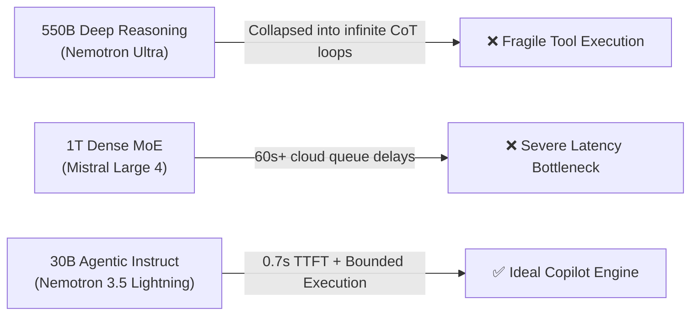

# LLM Evaluation & Model Selection

> **Summary:** Normie relies on an LLM as an orchestrator and natural language interface, while all mathematical correctness (attribute closure, normal forms, SQL AST parsing, ACID transactions) is enforced by deterministic Python tools. This document records the empirical evaluation of the three models tested for the Copilot, detailing why **Nemotron 3 Ultra (550B)** and **Mistral Large 4 (1T)** were rejected, and why **Nemotron 3.5 Lightning (30B)** was selected for production.

---

## 1. System Requirements for the Copilot

Under [`AGENTS.md`](../AGENTS.md), the core architectural principle is:
> **"Deterministic where correctness matters, LLM where language matters."**

The model is not expected to memorize table data or compute mathematical closures in its weights. Instead, it must satisfy three operational criteria:
1. **Flawless Multi-Tool Calling**: Accurately serialize and invoke **15 specialist tools** (`get_schema`, `run_query`, `propose_change`, `discover_fds`, `analyze_normalization`, etc.), several of which feature deeply nested schemas (such as `design_from_er` with entities, attributes, cardinalities, and ISA generalizations).
2. **Low Time-to-First-Token (TTFT)**: Stream conversational deltas and reasoning within 1–2 seconds so the browser UI remains responsive.
3. **Resilience Against Token Collapse**: Operate reliably without infinite repetition loops, empty outputs (`content: null`), or PydanticAI retry exhaustion.

---

## 2. Models Evaluated

### Comparison Summary

| Metric / Feature | NVIDIA Nemotron 3 Ultra (`550b-a55b`) | Mistral Large 4 (`1t-a52b`) | NVIDIA Nemotron 3.5 Lightning (`30b-a3b`) |
|---|---|---|---|
| **Parameter Scale** | 550 Billion (Dense) | 1 Trillion (MoE, 52B active) | 30 Billion (Agentic / MoE) |
| **Reasoning Architecture** | Unbounded Chain-of-Thought (`reasoning_content`) | Standard Instruction / Direct Response | Bounded / Fast-path Agentic Reasoning |
| **Time-to-First-Token** | Variable (often stuck in reasoning) | > 60s (frequent HTTP read timeouts) | **0.57s – 0.71s** |
| **Tool Calling Reliability** | ❌ Broken under complex schemas | ✅ Clean and native | ✅ **Flawless and instantaneous** |
| **PydanticAI Compatibility** | ❌ Fails (`UnexpectedModelBehavior`) | ✅ Supported | ✅ **Supported** |
| **Production Verdict** | **REJECTED** | **REJECTED** | **SELECTED (Active in Production)** |

---

## 3. Deep-Dive: Model Analysis

### 3.1. NVIDIA Nemotron 3 Ultra (`nvidia/nemotron-3-ultra-550b-a55b`)

#### Why It Was Evaluated
With 550 billion parameters, Nemotron 3 Ultra is one of the largest open-weights models available on NVIDIA NIM. It was selected initially for its theoretical depth, reasoning benchmarks, and ability to handle complex system prompts.

#### Why It Was Rejected
1. **Autoregressive Mode Collapse (Repetition Loops)**:
   - Nemotron 3 Ultra is an explicit reasoning model that emits internal chain-of-thought tokens through a separate channel (`reasoning_content`) before generating user-facing text or tool calls.
   - When configured with low temperature (`temperature=0.2`), the model experienced catastrophic greedy decoding loops. Its self-attention heads became trapped repeating subword tokens:
     ```text
     ational(NNN(NNNNIn( (NN((PInInNN,In(nnPP NNPP(antInNN‑The────NNInNNPP...
     ```
2. **Tool Schema Incompatibility on NIM**:
   - When all 15 database tools were attached, the server-side prompt template on NVIDIA NIM misaligned with the model's special token parser.
   - Instead of emitting a function call (e.g. `call: get_schema`), the model generated reasoning tokens, exhausted its token budget, and abruptly terminated with `finish_reason: "stop"`, `content: null`, and zero tool calls.
3. **PydanticAI Retry Exhaustion**:
   - Because PydanticAI received an empty assistant turn with no content and no tool calls, it initiated automatic retries. The model repeated the exact token loop on both retries, resulting in:
     ```text
     pydantic_ai.exceptions.UnexpectedModelBehavior: Exceeded maximum output retries (2)
     ```
4. **Temperature Sensitivity**:
   - We empirically tested raising the temperature to `0.7`, `0.8`, and `1.0` (with `top_p=0.95`). While this prevented simple greedy repetition, the model still emitted corrupted multilingual token fragments (`'ارف'`, `'_ ( member[... sách人,泍那些'`) and failed to invoke tools.

---

### 3.2. Mistral Large 4 (`mistralai/mistral-large-4-1t-a52b`)

#### Why It Was Evaluated
Mistral Large 4 is a 1-Trillion parameter flagship Mixture-of-Experts model. Mistral models are renowned for exceptional code generation, SQL synthesis, and strict adherence to the OpenAI function-calling standard.

#### Why It Was Rejected
1. **Extreme Queue Delays & HTTP Read Timeouts**:
   - Serving a 1-Trillion parameter model requires extensive tensor parallelism across GPU clusters. On the hosted NVIDIA NIM endpoint, user queries regularly sat in upstream queues for over **60 seconds** before the connection began streaming.
   - In production, client connections frequently dropped with:
     ```text
     ERROR: The read operation timed out (after 60.25s)
     ```
2. **Perceived System Unresponsiveness**:
   - From the user's perspective in the browser UI, clicking "Send" produced no initial reaction, no thinking indicator, and no progress for over a minute, making the platform appear frozen or broken.
3. **Compute Overkill for Tool Orchestration**:
   - Since Normie delegates relational algebra verification, candidate key generation, and normal form checks to deterministic Python algorithms, routing basic intents through a 1-Trillion parameter model introduced unnecessary latency without proportional benefit.

---

### 3.3. NVIDIA Nemotron 3.5 Lightning (`nvidia/nemotron-3.5-lightning-30b-a3b`) — **Selected Model**

#### Why It Is Preferred & Active in Production
1. **Sub-Second Latency & Instant TTFT**:
   - Connects in **0.57s** and streams the first token in **0.71s**.
   - Full tool executions (including schema introspection and audit log checking) complete end-to-end in **2.7s**.
2. **Bounded, Agentic Reasoning**:
   - Nemotron 3.5 Lightning is instruction-tuned specifically for agentic execution. Rather than spending thousands of tokens in unconstrained philosophical speculation, it uses a concise, bounded reasoning budget (~10–30 tokens) to orient intent and immediately triggers the target tool.
3. **Flawless Tool Schema Serialization**:
   - In benchmark tests against all 15 Normie specialist tools—including multi-level nested models like `design_from_er` (entities, attributes, types, keys, relationships, and cardinalities)—it serialized valid arguments with zero schema violations on the first attempt.
4. **Zero Degeneracy**:
   - Operates cleanly across standard sampling temperatures (`0.2` to `0.7`) without token collapse, foreign-script hallucinations, or empty `content: null` responses.

---

## 4. Architectural Takeaway

For agentic systems that adhere to the *"Deterministic where correctness matters, LLM where language matters"* philosophy:



**Bigger is not always better for agent copilots.** When the application offloads mathematical and structural correctness to deterministic tools, an ultra-fast, agentic-aligned model like **Nemotron 3.5 Lightning** dramatically outperforms massive 500B+ reasoning models in speed, reliability, and user experience.
